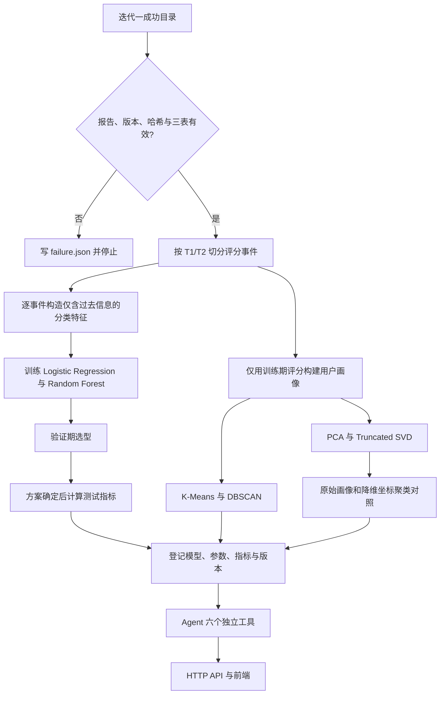

# 迭代二文件、流程、测试与视频演示

## 文件作用

| 文件 | 作用 |
| --- | --- |
| `analysis/__init__.py` | 声明迭代二分析包。 |
| `analysis/data.py` | 校验迭代一产物、加载 MovieLens 三表、按 `T1/T2` 切分、构造时间安全分类特征和训练期用户画像。 |
| `analysis/training.py` | 训练六种算法，执行验证/测试评价，生成版本、模型、群体、坐标、指标、SVG 和 Markdown 报告。 |
| `analysis/tools.py` | 将六种算法封装成独立 Agent 工具，只读取或登记实际结果，并处理自定义聚类/降维参数。 |
| `analysis/web.py` | 实现自然语言任务识别、双算法默认调用、异步状态、追问和 HTTP API。 |
| `analysis/index.html` | 提供问题输入、状态、三类结果、实验对照、局限、追问、报告、JSON 和二维图页面。 |
| `tests/test_analysis.py` | 构造版本化测试产物并验证契约、时间切分、六算法、参数化拟合、失败状态和 Agent 行为。 |
| `docs/requirements/迭代二_分类聚类降维与分析Agent.md` | 保存迭代二需求原文。 |
| `docs/iteration2/README.md` | 说明范围、依赖、运行方式、评价口径和结果目录。 |
| `docs/iteration2/files-flow-and-testing.md` | 说明本文件表、整体流程、接口、验收矩阵和演示脚本。 |
| `pyproject.toml` | 增加 NumPy、Joblib、scikit-learn 依赖及两个迭代二命令入口。 |
| `uv.lock` | 固定实际解析的依赖版本。 |
| `.gitignore` | 忽略本地 `analysis-runs/` 训练产物。 |

## 整体流程



## 防止时间泄漏

1. 所有评分按 `(Timestamp, 原始顺序)` 排序。
2. 构造一条分类样本时，先读取用户、电影和全局的历史统计，再把当前评分写入统计。
3. 训练只使用 `timestamp <= T1` 的分类样本。
4. 验证集只用于比较算法；测试集不参与选择。
5. 在线分类特征从单独保存的训练期状态生成，截止时间固定为 `T1`。
6. 用户画像、聚类和降维只读取训练期评分，不读取验证期或测试期评分。

## 六个 Agent 工具

| 工具名 | 输入 | 输出重点 |
| --- | --- | --- |
| `classify_logistic_regression` | `user_id`, `movie_id` | 预测类别、正类概率、模型版本、参数、验证/测试指标 |
| `classify_random_forest` | `user_id`, `movie_id` | 预测类别、正类概率、模型版本、参数、验证/测试指标 |
| `cluster_kmeans` | `user_ids`, 可选 `parameters` | 群体、摘要、画像、版本、指标 |
| `cluster_dbscan` | `user_ids`, 可选 `parameters` | 群体、摘要、噪声标记、版本、指标 |
| `reduce_pca` | `user_ids`、维数/阈值、对照聚类 | 坐标、信息保留、聚类对照、资源开销、SVG |
| `reduce_truncated_svd` | `user_ids`、维数/阈值、对照聚类 | 坐标、信息保留、聚类对照、资源开销、SVG |

未知用户、未知电影、训练历史不足、模型文件缺失、未完成结果、非法参数或路径越界均返回失败，不生成占位数据。

## HTTP API

| 方法与路径 | 用途 |
| --- | --- |
| `POST /api/jobs` | 创建分类、聚类或降维任务。 |
| `GET /api/jobs/<任务ID>` | 查询状态、阶段、失败原因或实际结果。 |
| `POST /api/jobs/<任务ID>/ask` | 依据该任务实际结果回答追问。 |
| `GET /api/jobs/<任务ID>/report` | 获取本次训练评价报告。 |
| `GET /api/jobs/<任务ID>/sample` | 获取本次查询实际结果 JSON。 |
| `GET /api/jobs/<任务ID>/plot/<算法>` | 获取该降维算法的 SVG 图。 |

分类请求示例：

```json
{
  "prompt": "请用两种分类算法预测是否会给高分",
  "user_id": 1,
  "movie_id": 10
}
```

参数化聚类请求示例：

```json
{
  "prompt": "请用 K-Means 聚类用户",
  "user_ids": [1, 2, 3],
  "algorithm": "kmeans",
  "parameters": {"n_clusters": 3, "n_init": 20}
}
```

参数化降维请求示例：

```json
{
  "prompt": "请用 PCA 降维并与 DBSCAN 对照",
  "user_ids": [1, 2, 3],
  "algorithm": "pca",
  "target_dimensions": 2,
  "cluster_algorithm": "dbscan",
  "cluster_parameters": {"eps": 1.5, "min_samples": 2}
}
```

## 实际验收矩阵

| 验收项 | 实际检查 |
| --- | --- |
| 迭代一契约 | 成功报告、必需版本、三表 SHA-256、重算数据版本、字段/评分/外键、非空切分 |
| 时间安全 | 48/16/16 小型切分、事件前统计、训练期查询状态、训练期画像 |
| 分类 | 两模型真实拟合、概率、类别、验证/测试指标、未知 ID |
| 聚类 | 两算法真实拟合、摘要、噪声点、自定义 K-Means/DBSCAN 参数、非法参数 |
| 降维 | PCA/SVD、目标维数、信息阈值、K-Means/DBSCAN 对照、ARI、耗时、内存、SVG |
| 登记与产物 | 六个模型、画像、群体、坐标、报告、版本、参数化查询目录 |
| Agent | 默认双算法、指定单算法、失败状态、追问只引用本次结果 |
| HTTP | 创建/轮询、报告、样例、图表、追问、400/404/409 与未知用户失败 |
| 前端 | 分类结果、降维对照、状态、指标、版本、局限、追问、SVG 加载和控制台错误 |

专项测试实际使用 8 个用户、8 部电影、80 条评分，训练/验证/测试分别为 48/16/16。它验证真实算法链路但不是 MovieLens 1M 全量实验，因此演示时必须称为“小型真实验收数据”，不能把其中指标表述为全量结果。

## 视频演示顺序

### 1. 开场与前置条件

展示需求文件和迭代一成功目录，说明：

- 本轮读取迭代一清洗数据、数据版本、报告和 `T1/T2`；
- 版本或哈希不一致会停止，不会用示例数据替代；
- 当前演示若使用小型数据，只证明流程真实可运行，不代表全量指标。

### 2. 训练过程

执行训练命令，依次指出终端阶段：时间安全特征、两种分类算法、训练期画像、两种聚类、两种降维与对照。训练完成后打开 `registry.json` 和 `report.md`，展示数据版本、切分、六算法参数和实际指标。

### 3. 分类演示

页面输入：

```text
请使用两种分类算法对照预测该用户是否会给目标电影不低于 4 分。
```

输入有效 `UserID` 和 `MovieID`，展示两种算法、类别、概率、模型版本、指标和局限。随后输入未知 `UserID`，展示明确失败状态。

### 4. 聚类演示

页面输入：

```text
请用两种算法比较这些用户的群体归属和群体解释。
```

输入用户集合，展示 K-Means 与 DBSCAN 的群体归属、群体摘要、评价指标和 DBSCAN 噪声标记。再选择单一算法并输入参数 JSON，说明结果已保存到 `queries/<结果版本>/`。

### 5. 降维演示

页面输入：

```text
请比较 PCA 和 Truncated SVD，并展示压缩前后的聚类差异。
```

展示原始维数、实际维数、信息保留、ARI、耗时、峰值内存和二维 SVG。再指定目标维数或信息阈值，并选择一种对照聚类算法；强调目标维数与阈值只能二选一。

### 6. 证据与追问

点击报告和结果 JSON，证明页面与登记结果一致。追问：

```text
两种算法的评价指标有什么差异？
```

展示回答只复述本次已登记指标，不调用外部大模型、不补造结论。

### 7. 测试与结尾

运行专项测试和完整回归，展示通过数量。结尾明确区分：预测、统计描述、可验证指标、局限；如果没有使用 MovieLens 1M 全量迭代一产物，不宣称得到全量评价结果。
